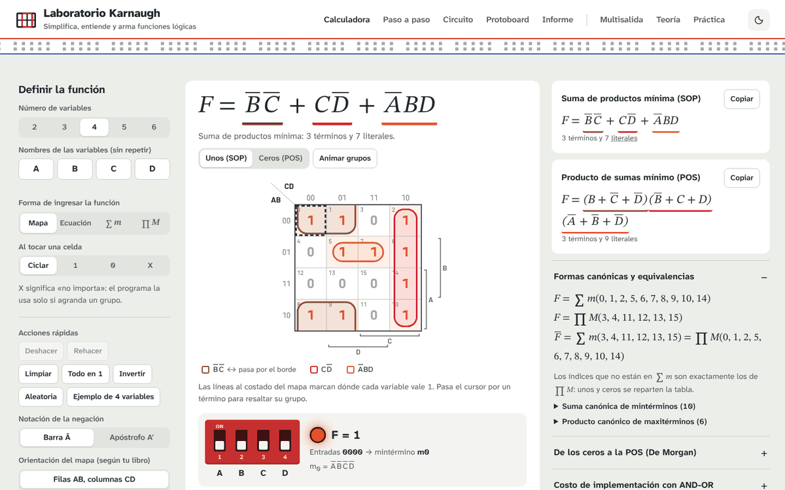
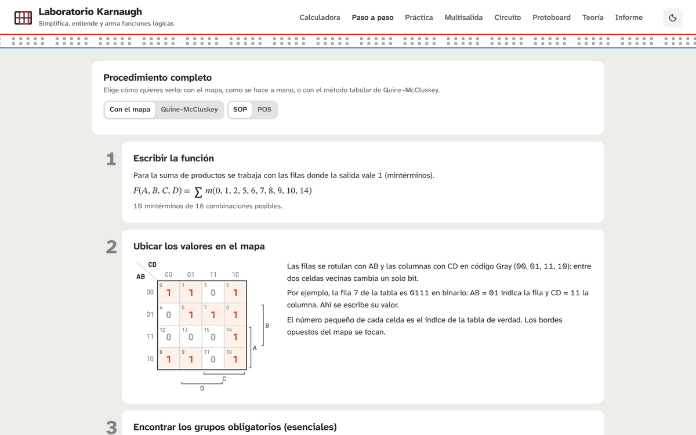
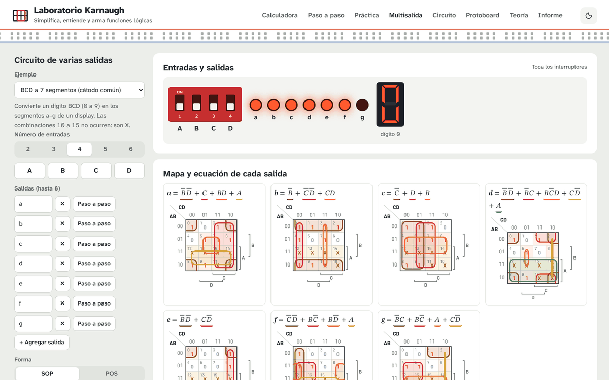
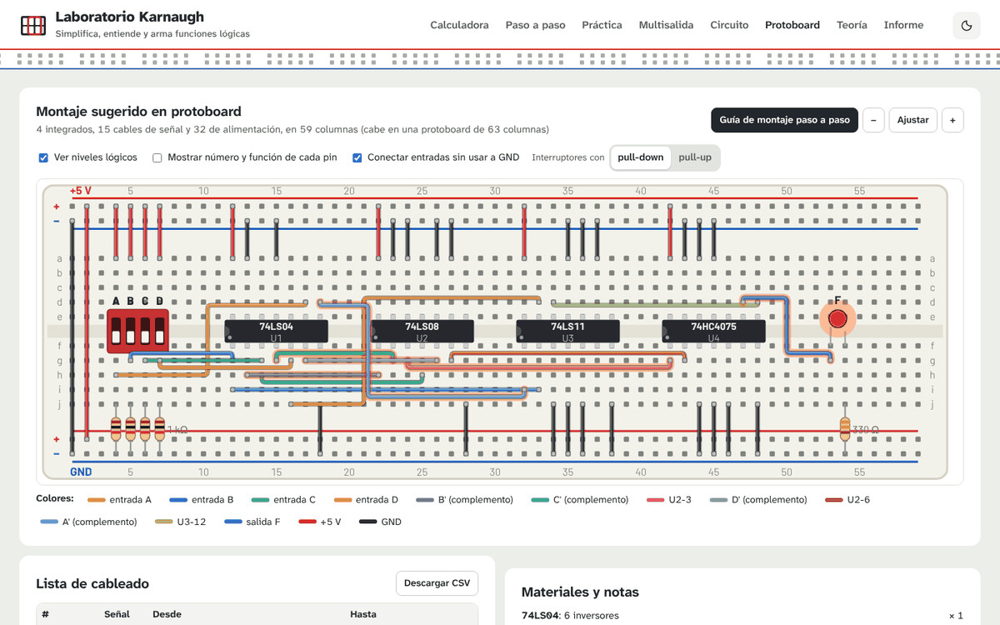

# Laboratorio Karnaugh

**Simplifica, entiende y arma funciones lógicas con mapas de Karnaugh, directamente en el navegador.**

[](https://github.com/andresdasugo/Karnaugh/actions/workflows/ci.yml)
[](https://github.com/andresdasugo/Karnaugh/actions/workflows/pages.yml)
[](LICENSE)


### ▶ [Abrir el laboratorio](https://andresdasugo.github.io/Karnaugh/)

Funciona en cualquier navegador moderno (Chrome, Edge, Firefox, Safari), en computador, tableta o celular. No requiere instalación, cuenta ni registro: es una sola página web y todo el cálculo se hace en tu propio equipo.



---

## Qué puedes hacer

| Pestaña | Para qué sirve |
| --- | --- |
| **Calculadora** | Define la función tocando el mapa o la tabla de verdad, escribiéndola como ecuación (`a'b + c(a + !d)`) o como lista ∑m / ∏M, con condiciones de no importa (X). Obtén al instante la SOP y la POS mínimas, las formas canónicas, el costo en compuertas, los riesgos estáticos, el diagrama de tiempos y la exportación a VHDL, Verilog, C/Arduino, Python, LaTeX y Logisim. |
| **Paso a paso** | El procedimiento completo explicado: con el mapa (como se hace a mano) o con el método tabular de **Quine–McCluskey** y el método de **Petrick**. |
| **Práctica** | Ejercicios aleatorios: forma tú los grupos, recibe retroalimentación y un puntaje, y comprueba tu ecuación final. |
| **Multisalida** | Circuitos de varias salidas con términos compartidos: decodificador BCD a 7 segmentos, sumador completo, comparador, BCD a exceso 3, decodificador 2 a 4, binario a Gray o tu propio diseño. |
| **Circuito** | Diagrama lógico con AND-OR, solo NAND, solo NOR o XOR, compuertas de 2 o hasta 4 entradas y la lista de integrados 74LS / 74HC. Interruptores interactivos para simularlo. |
| **Protoboard** | Montaje sugerido en protoboard con guía cable por cable, lista de cableado descargable en CSV y notas para energizar sin dañar los integrados. |
| **Teoría** | Curso interactivo: álgebra de Boole, mintérminos y maxitérminos, código Gray, adyacencias, implicantes principales, mapas de 5 y 6 variables, riesgos, NAND/NOR, integrados 74xx, autoevaluación, glosario y bibliografía. |
| **Informe** | Genera un informe en PDF listo para entregar, con la tabla, los mapas, el procedimiento, el circuito y el montaje. |

Otras características:

- Mapas de **2 a 6 variables**, con orientación configurable y la convención «espejo» para 5 y 6 variables.
- Negación con barra (Ā) o con apóstrofo (A′), según tu libro.
- Deshacer y rehacer (Ctrl+Z / Ctrl+Y), tema claro y oscuro, diseño adaptado al celular.
- Tu trabajo se guarda automáticamente en el navegador.

| Paso a paso | Multisalida | Protoboard |
| --- | --- | --- |
|  |  |  |

## Compartir un ejercicio

En la calculadora, abre **«Compartir o cargar un ejercicio»** y copia el código de la función (por ejemplo `K4-A.B.C.D-1110011111100010`). Tus compañeros pueden pegarlo en el mismo lugar, o puedes enviarles un enlace que abre el ejercicio directamente agregando `#k=` y el código al final de la dirección:

```
https://andresdasugo.github.io/Karnaugh/#k=K4-A.B.C.D-1110011111100010
```

## Usarlo sin conexión

1. Descarga el repositorio con **Code → Download ZIP** y descomprímelo.
2. Abre `index.html` con tu navegador (doble clic).

Todo funciona sin internet; solo las tipografías se reemplazan por las del sistema. La librería de PDF viene incluida en `vendor/`.

## Para desarrolladores

El laboratorio es una sola página HTML con CSS y JavaScript sin dependencias de compilación.

```
.
├── index.html            # la aplicación completa
├── favicon.svg
├── vendor/jspdf/         # jsPDF 2.5.1 (MIT) para el informe en PDF
├── tests/                # pruebas del núcleo lógico (node:test)
├── docs/img/             # capturas para este README
└── .github/workflows/    # pruebas automáticas y publicación en GitHub Pages
```

El núcleo lógico (objeto `K` dentro de `index.html`) no usa el DOM: contiene el código Gray y la geometría del mapa, Quine–McCluskey, la cobertura mínima exacta (esenciales + ramificación y poda), el analizador de ecuaciones, la construcción de circuitos, la asignación a integrados 74xx y la exportación a Logisim. Las pruebas lo cargan directamente desde `index.html`, así que siempre prueban el mismo código que usan los estudiantes.

Requisito: [Node.js](https://nodejs.org/) 18 o superior (solo para pruebas y servidor local).

```bash
npm test        # ejecuta las pruebas del núcleo lógico
npm start       # sirve el sitio en http://localhost:8080
```

Las pruebas comprueban, entre otras cosas, que la SOP y la POS reproducen la tabla de verdad en cientos de funciones aleatorias de 2 a 6 variables, que la cobertura es mínima en las 256 funciones de 3 variables y que los circuitos AND-OR, NAND, NOR, XOR y multisalida son correctos.

### Publicación

Cada cambio en la rama `main` se publica automáticamente en GitHub Pages mediante el flujo `.github/workflows/pages.yml`, después de pasar las pruebas.

## Contribuir

Los reportes de errores y las sugerencias son bienvenidos en [Issues](https://github.com/andresdasugo/Karnaugh/issues). Lee [CONTRIBUTING.md](CONTRIBUTING.md) antes de proponer cambios.

## Licencia

[MIT](LICENSE) © 2026 andresdasugo. jsPDF se distribuye bajo su propia licencia MIT ([vendor/jspdf/LICENSE](vendor/jspdf/LICENSE)).

## Referencias

- M. Morris Mano y Michael D. Ciletti. *Diseño digital*. Pearson.
- Thomas L. Floyd. *Fundamentos de sistemas digitales*. Pearson.
- Ronald J. Tocci, Neal S. Widmer y Gregory L. Moss. *Sistemas digitales: principios y aplicaciones*. Pearson.
- Maurice Karnaugh. «The Map Method for Synthesis of Combinational Logic Circuits». *Transactions of the AIEE, Part I*, vol. 72, n.º 5, 1953.
- [Logisim-evolution](https://github.com/logisim-evolution/logisim-evolution), simulador de circuitos lógicos de código abierto.
